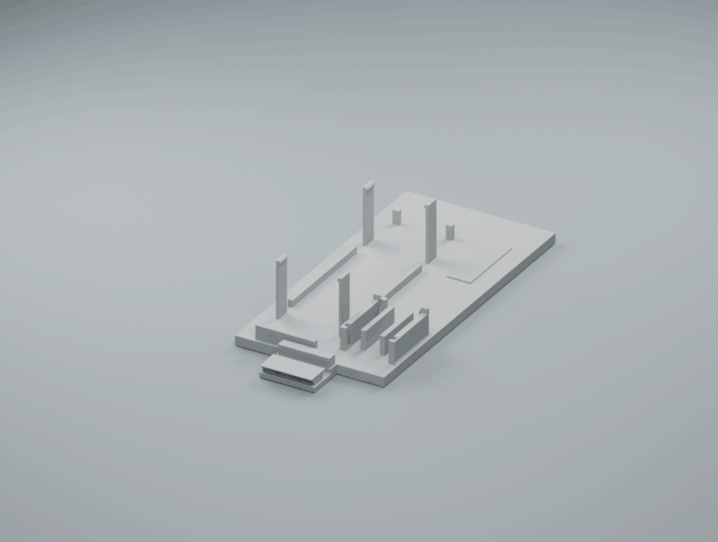

# Team 2 · Cardboard Camera

The battery is optional; the module can run on USB power. The outer shell is up to your group—get creative with its shape, materials and decoration!

## Assembly

[Watch / download video](media/Assembly.mp4)

## Print files

[Sled](design/cardboard-camera/Electronics%20Sled.stl) · [ESP lock](design/cardboard-camera/ESP%20Lock.stl) · [Radar holder](design/cardboard-camera/Radar%20Holder.stl) · [Front cover](design/cardboard-camera/Front%20Cover.stl)

[Assembly & wiring instructions](docs/BUILD_GUIDE.md)

## ESP firmware

**[Flash from a Mac](firmware/Concept1_Camera/README.md#flash-from-a-mac)** · [ESP source code](firmware/Concept1_Camera/Concept1_Camera.ino)

Wi-Fi setup: join **team2-radar** (password **aqswdefr**), open **http://192.168.4.1**, enter venue Wi-Fi and select your team.

## Challenge 2

[All heist firmware & wiring](challenge-2/) · [Laser schematic](challenge-2/output/pdf/Team2_Laser_Wiring.pdf) · [Skidule knobs](design/potentiometer-knobs/) · [Software module](https://github.com/beraltan/team-2-software-module)

Camera → Skidule → Morse → laser → vault. The shared-config firmware package lists the exact C3, C6 and S3 targets and uses one local Wi-Fi file.
