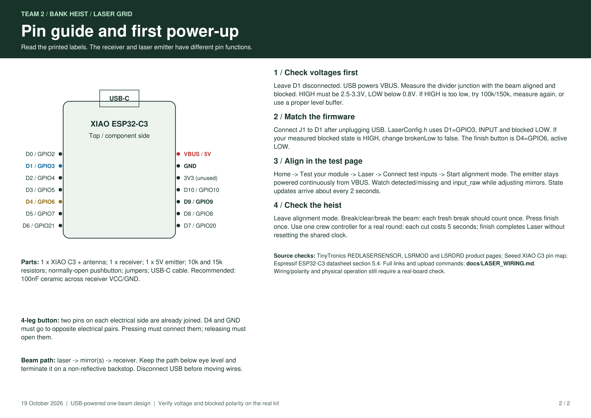

# Laser wiring images

Two landscape A4 images at **300 dpi** (3508 x 2481 pixels), suitable for
printing or sharing with the person building the module. Click an image to
open the full-resolution version.

## Complete schematic

VBUS/5V power, one receiver, the 10k/15k divider to D1/GPIO3, and the finish
button to D4/GPIO6. The notes cover both documented TinyTronics emitter pinouts.

[](laser-wiring.png)

## Pin guide and setup

XIAO ESP32-C3 orientation, header labels, voltage and polarity checks, and
mirror-alignment steps.

[](laser-pin-guide.png)

[Full wiring instructions](../LASER_WIRING.md) |
[Printable PDF](../../output/pdf/Team2_Laser_Wiring.pdf) |
[Editable SVG schematic](laser-wiring.svg)

Re-export images from the existing PDF without changing the document:

```powershell
uv run --with pymupdf python scripts/laser_images.py
```

Run `scripts/draw-laser-wiring.py` to regenerate the PDF, SVG and both PNGs
together. Firmware and circuit behaviour are unchanged by the image export.
