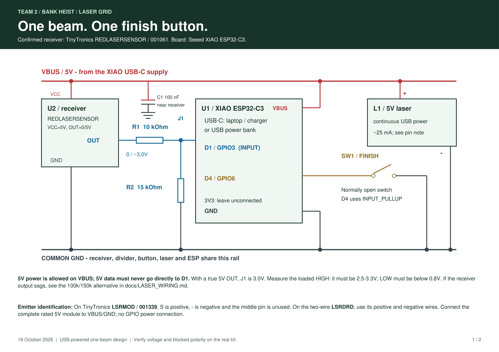

# Parts and wiring

Wire with power disconnected. Use a common ground and keep ESP inputs at or below 3.3 V.

## Camera — XIAO ESP32-C3

| Component | Connection |
| --- | --- |
| LD2450 power / ground | 5V / GND |
| LD2450 TX | D7 / GPIO20, ESP receive |
| LD2450 RX | D6 / GPIO21, ESP transmit |
| RGB red / green / blue | D0 / D1 / D2, each through 220 Ω |
| RGB common cathode | GND |

Check the purchased LED's lead order. Power from one USB source; use assembled charging electronics for an optional battery, never a bare cell on 5V.

## Morse — XIAO ESP32-C6

The included `Morse_Button` sketch uses a three-wire active-HIGH button: **3V3**, **GND**, signal **D3/GPIO21**. For a bare switch between D3 and GND, set `BUTTON_ACTIVE_LOW = true` in the sketch.

## Skidule — XIAO ESP32-C6

| Component | Connection |
| --- | --- |
| 10 kΩ slider ends | 3V3 / GND |
| Slider wiper | A0 / GPIO0 |
| 10 kΩ rotary pot ends | 3V3 / GND |
| Rotary wiper | A1 / GPIO1 |
| Confirmation switch | D4 / GPIO22 to GND |

The switch uses the internal pull-up. Calibrate `SLIDER_RAW_MIN/MAX` and `KNOB_RAW_MIN/MAX` independently. The supplied four-bar sketch is a compatible replacement for the teammate's calibrated ten-position sketch.

## Laser — final C6 and archived C3 alternative

The physical build used a **XIAO ESP32-C6**. Its final sketch and pin map have not been recovered. `Laser_Grid` and the diagram below are the **C3 alternative**, not C6 wiring.

| C3 alternative | Connection |
| --- | --- |
| 5 V laser emitter and receiver | USB VBUS/5V and common GND |
| Receiver OUT | 10 kΩ to a junction connected to D1/GPIO3 |
| Junction to ground | 15 kΩ; the divider reduces nominal 5 V to 3 V |
| Bare finish switch | D4/GPIO6 to GND, internal pull-up |

Measure the loaded receiver signal with the beam received and blocked before connecting the GPIO. It must stay within 3.3 V and give distinct LOW/HIGH levels. If the output is too weak through the divider, use a suitable buffer; do not connect a 5 V signal directly. Check `brokenLow` against the actual receiver. The emitter stays powered continuously.

[Printable C3 schematic](../challenge-2/output/pdf/Team2_Laser_Wiring.pdf) · [Editable schematic](../challenge-2/docs/schematics/laser-wiring.svg)

## Vault — ESP32-S3

| Component | Connection |
| --- | --- |
| Servo 1 / 2 signal | GPIO4 / GPIO5 |
| Servo grounds | Common GND |
| Servo power | Suitable regulated 5 V supply |

Do not power motors from GPIOs or 3V3. Check the board's USB power path before using VBUS, and do not join competing 5 V supplies. Defaults are 90° locked and 0° unlocked; adjust endpoints to the mechanism before attaching it. The S3 and both servos were reused from an earlier project.

[LD2450 manual](https://www.tinytronics.nl/product_files/006000_HLK-LD2450-Instruction-Manual.pdf) · [XIAO C3 pin map](https://wiki.seeedstudio.com/XIAO_ESP32C3_Getting_Started/#pin-map)
